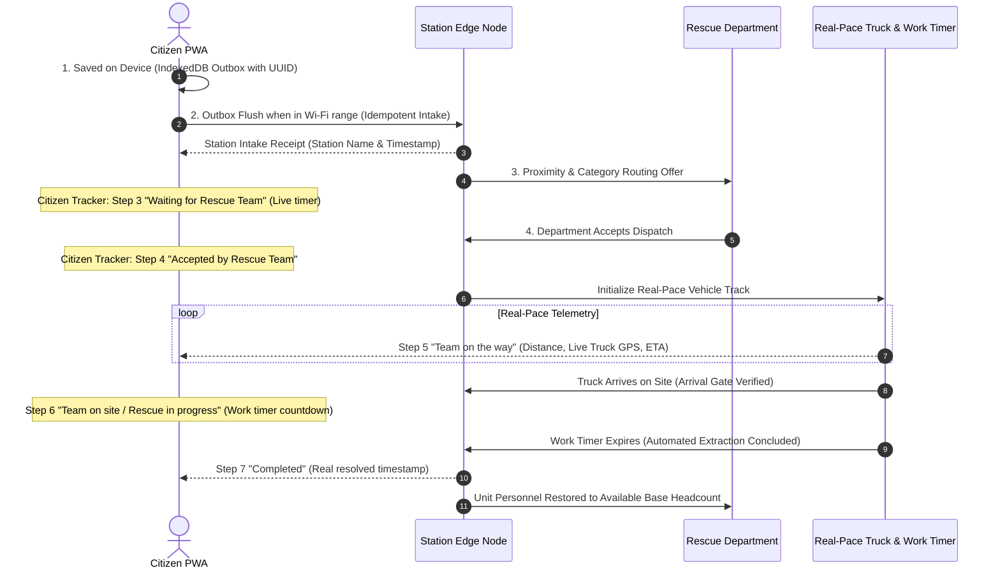

# AmeniEdge
> **Resilient Edge Mesh. Localizing Lifelines When the Grid Goes Dark.**

AmeniEdge is an offline-first emergency reporting and rescue coordination platform with a multi-station command hierarchy. Engineered for acute grid failure, hurricane storm surge, and telecommunications collapse, AmeniEdge ensures that citizens can submit SOS calls, rescue teams can execute missions, and local stations can dispatch assets without requiring an active internet connection.

---

## 1. System Architecture & Two-Layer Edge Mesh

- **Autonomous Station Edge Layer (Local Island Mode)**:
  - Powered Linux device (Raspberry Pi 4/5 or field laptop) emitting a local Wi-Fi Access Point (`hostapd` + `dnsmasq`) with captive portal redirection.
  - Zero-webfont React 18 + Vite PWA precached by Workbox into client browser storage.
  - Autonomous Java 21 + Spring Boot 3 edge service (REST + STOMP WebSockets).
  - Embedded H2/PostgreSQL database with sync event journals and client idempotency.
  - Local Leaflet OpenStreetMap raster tile cache (`GET /api/v1/maps/tiles/{z}/{x}/{y}`).
  - **RescueFit Engine**: Rules-based dispatch matching teams by skills, equipment, workload, and proximity with 100% human-readable explainability.
- **Central Regional Layer**:
  - Central Spring Boot API with PostGIS spatial engine, mutual TLS inter-station sync harmonizer, and cryptographic audit vault.
  - Multi-station conflict detection and regional resource escalation.

---

## 2. How It Works (Autonomous Disaster Response Flow)

For an in-depth breakdown of networking modes, outbox lifecycles, and cryptographic sync, see [docs/HOW_IT_WORKS.md](docs/HOW_IT_WORKS.md).



### Complete 7-Step Citizen Tracker Semantics

Unlike legacy systems that show premature green checkmarks, AmeniEdge uses **four decoupled state dimensions** (`deliveryState`, `assignmentState`, `missionState`, `syncState`) and logs verified timestamps:

1. **Saved on this device**: Moment the phone stores the encrypted SOS outbox payload.
2. **Received by station**: Verified receipt from station API with station name.
3. **Waiting for a rescue team**: Live waiting timer; reverts to waiting with decline reason if declined.
4. **Accepted by <TeamName>**: Only ticks after the unit crew explicitly accepts.
5. **Team on the way**: Real-pace navigation with remaining distance and ETA.
6. **Team on site / Rescue in progress**: Physical arrival gate verified; live work countdown timer.
7. **Completed**: Concluded only after on-site mission resolution.

---

## 3. Quickstart & Local Development

### Prerequisites

- Node.js 20+ and Java 21+ (Oracle JDK 21/26)
- Maven 3.9+ (or `./mvnw`)
- Docker and Docker Compose (v2.20+)

---

### Database Setup (PostGIS 16-3.4)

AmeniEdge utilizes PostgreSQL 16 with the PostGIS extension for geospatial radius queries, incident triage proximity, and station coverage mapping.

#### 1. Start the PostGIS Container

```bash
docker compose -f infra/docker-compose.dev.yml up -d
```

*Starts `postgis/postgis:16-3.4` with a named volume `ameniedge_dev_pgdata`, automatic health check, and mounts Flyway migration/seed scripts.*

#### 2. Verify with `psql` or Database GUI

Connect using any PostgreSQL GUI (pgAdmin, DBeaver) or CLI:

```bash
# Connect using psql inside container or locally:
docker exec -it ameniedge-dev-db psql -U amenedge -d amenedge

# Inside psql, verify PostGIS extension:
SELECT PostGIS_Full_Version();

# Verify seeded stations and users:
SELECT id, name, status FROM stations;
SELECT id, username, role FROM users;
```

#### 3. How to Reset the Database

To clear all data, wipe volumes, and re-run migrations from scratch:

```bash
docker compose -f infra/docker-compose.dev.yml down -v
docker compose -f infra/docker-compose.dev.yml up -d
```

---

### Running the Backend

#### Option A: Running with Local PostGIS (Dev Profile - Recommended)

Ensure Docker PostGIS is running, then:

```bash
cd backend
mvn clean compile
mvn spring-boot:run
```

*Spring Boot connects to `jdbc:postgresql://localhost:5432/amenedge` (user: `amenedge`, pass: `amenedge`) and runs Flyway migrations automatically.*

#### Option B: Standalone Edge / Offline Mode (Embedded H2)

To run the backend without starting Docker or external PostgreSQL:

```bash
cd backend
mvn spring-boot:run "-Dspring-boot.run.profiles=station-edge"
```

*Uses an embedded file-backed H2 engine at `./data/ameniedge_station` with full PostgreSQL compatibility mode.*

#### Configuring the Server Port (Default: 8081)

AmeniEdge defaults to port 8081 to avoid conflict with standard services:

```bash
# Set SERVER_PORT or override via command line:
mvn spring-boot:run "-Dspring-boot.run.arguments=--server.port=8081"
```

#### Verifying Health Endpoints

- **Spring Boot Actuator Health**: `GET http://localhost:8081/actuator/health` (returns `{"status":"UP", ...}`)
- **AmeniEdge Edge Mesh Diagnostic**: `GET http://localhost:8081/api/v1/health` (returns station operational state, outbox queue count, active responder teams)
- **Swagger UI Interactive Documentation**: `http://localhost:8081/swagger-ui.html`

---

### Running Frontend

```bash
cd frontend
npm install
npm run dev
```

*Frontend runs at `http://localhost:5173`. Proxies `/api/v1` and `/ws` to backend on port 8081.*

### Running with Docker Compose

```bash
docker compose up --build
```

---

## 4. Default Rescue Team Logins & Demo Accounts

> [!WARNING]
> **DEVELOPMENT ONLY — SECURITY WARNING**:
> The accounts below are pre-seeded strictly for local development, rapid evaluation, and unit testing. All passwords use BCrypt hashing in Flyway migrations. **These accounts MUST be disabled, deleted, or replaced with strong unique credentials before deploying to any production or field-operational network.**

### Complete Pre-Seeded Accounts & Role Routing Matrix (23 Verified Accounts)

| Station / Jurisdiction | Department / Role | Username / Email | Password | Assigned Unit ID | Dashboard Route | Top Bar Identity Display | Emergency Categories Received |
|---|---|---|---|---|---|---|---|
| **North Station - Anna Nagar** | Flood Rescue Team - North Station | `flood.north@amenedge.test` | `Flood@12345` | `TEAM-CHN-N-001` | `/team` | `Flood Rescue Team - North Station` | `FLOOD` |
| **North Station - Anna Nagar** | Fire Response Team - North Station | `fire.north@amenedge.test` | `Fire@12345` | `TEAM-CHN-N-002` | `/team` | `Fire Response Team - North Station` | `FIRE` |
| **North Station - Anna Nagar** | Emergency Medical Team - North Station | `medical.north@amenedge.test` | `Medical@12345` | `TEAM-CHN-N-003` | `/team` | `Emergency Medical Team - North Station` | `MEDICAL` |
| **North Station - Anna Nagar** | Search & Rescue Team - North Station | `sar.north@amenedge.test` | `Sar@12345` | `TEAM-CHN-N-004` | `/team` | `Search & Rescue Team - North Station` | `TRAPPED`, `MISSING` |
| **North Station - Anna Nagar** | Station Leader (Tactical Command) | `leader.north@amenedge.test` | `Leader@12345` | `STA-CHN-N-001` | `/leader` | `Station Leader - North Station` | `OTHER` (Triage), Capacity Escalations |
| **South Station - Tambaram** | Flood Rescue Team - South Station | `flood.south@amenedge.test` | `Flood@12345` | `TEAM-CHN-S-001` | `/team` | `Flood Rescue Team - South Station` | `FLOOD` |
| **South Station - Tambaram** | Emergency Medical Team - South Station | `medical.south@amenedge.test` | `Medical@12345` | `TEAM-CHN-S-002` | `/team` | `Emergency Medical Team - South Station` | `MEDICAL` |
| **South Station - Tambaram** | Fire Response Team - South Station | `fire.south@amenedge.test` | `Fire@12345` | `TEAM-CHN-S-003` | `/team` | `Fire Response Team - South Station` | `FIRE` |
| **South Station - Tambaram** | Search & Rescue Team - South Station | `sar.south@amenedge.test` | `Sar@12345` | `TEAM-CHN-S-004` | `/team` | `Search & Rescue Team - South Station` | `TRAPPED`, `MISSING` |
| **South Station - Tambaram** | Station Leader (Tactical Command) | `leader.south@amenedge.test` | `Leader@12345` | `STA-CHN-S-002` | `/leader` | `Station Leader - South Station` | `OTHER` (Triage), Capacity Escalations |
| **East Station - Royapuram** | Flood Rescue Team - East Station | `flood.east@amenedge.test` | `Flood@12345` | `TEAM-CHN-E-001` | `/team` | `Flood Rescue Team - East Station` | `FLOOD` |
| **East Station - Royapuram** | Fire Response Team - East Station | `fire.east@amenedge.test` | `Fire@12345` | `TEAM-CHN-E-002` | `/team` | `Fire Response Team - East Station` | `FIRE` |
| **East Station - Royapuram** | Emergency Medical Team - East Station | `medical.east@amenedge.test` | `Medical@12345` | `TEAM-CHN-E-003` | `/team` | `Emergency Medical Team - East Station` | `MEDICAL` |
| **East Station - Royapuram** | Search & Rescue Team - East Station | `sar.east@amenedge.test` | `Sar@12345` | `TEAM-CHN-E-004` | `/team` | `Search & Rescue Team - East Station` | `TRAPPED`, `MISSING` |
| **East Station - Royapuram** | Station Leader (Tactical Command) | `leader.east@amenedge.test` | `Leader@12345` | `STA-CHN-E-003` | `/leader` | `Station Leader - East Station` | `OTHER` (Triage), Capacity Escalations |
| **West Station - Ambattur** | Flood Rescue Team - West Station | `flood.west@amenedge.test` | `Flood@12345` | `TEAM-CHN-W-001` | `/team` | `Flood Rescue Team - West Station` | `FLOOD` |
| **West Station - Ambattur** | Fire Response Team - West Station | `fire.west@amenedge.test` | `Fire@12345` | `TEAM-CHN-W-002` | `/team` | `Fire Response Team - West Station` | `FIRE` |
| **West Station - Ambattur** | Emergency Medical Team - West Station | `medical.west@amenedge.test` | `Medical@12345` | `TEAM-CHN-W-003` | `/team` | `Emergency Medical Team - West Station` | `MEDICAL` |
| **West Station - Ambattur** | Search & Rescue Team - West Station | `sar.west@amenedge.test` | `Sar@12345` | `TEAM-CHN-W-004` | `/team` | `Search & Rescue Team - West Station` | `TRAPPED`, `MISSING` |
| **West Station - Ambattur** | Station Leader (Tactical Command) | `leader.west@amenedge.test` | `Leader@12345` | `STA-CHN-W-004` | `/leader` | `Station Leader - West Station` | `OTHER` (Triage), Capacity Escalations |
| **Regional Central** | Regional Supervisor | `supervisor@amenedge.test` | `Super@12345` | Regional Hub | `/supervisor` | `Regional Supervisor - Greater Chennai` | All Cross-Station Escalations |
| **HQ Governance** | Org Administrator | `admin@amenedge.test` | `Admin@12345` | Global Audit | `/admin` | `System Administrator` | System Configuration & Cryptographic Audit |
| **Civilian Public** | Registered Citizen | `citizen@amenedge.test` | `Citizen@12345` | Public Guest | `/app` | `Verified Citizen Arun` | Personal SOS Reports Tracker |

### Resetting Demo Data to Pure Clean State

To instantly purge all transactional records (incidents, assignments, tracks, allocations) and reset personnel pools:

```bash
# Windows PowerShell
./scripts/reset-demo-data.ps1

# Linux / Mac
./scripts/reset-demo-data.sh
```

---

## 5. Verification & Testing

### Backend Unit & Integration Tests (JUnit 5 + Mockito)

```bash
cd backend
mvn test
```

*Executes tests for RescueFit qualification & explainability, Incident state machine transitions, and Store-and-forward sync deduplication & conflict detection.*

### Frontend Unit Tests (Vitest + React Testing Library)

```bash
cd frontend
npm run test:unit
```

*Verifies 3-stage ProgressTracker rendering, design system tokens, and outbox persistence.*

### Mobile Responsive Integrity (Playwright)

```bash
cd frontend
npx playwright test
```

*Verifies 7 mandatory viewports (320x568, 360x800, 390x844, 412x915, 768x1024, 1024x768, 1440x900) ensuring zero horizontal scroll, touch targets >= 48px, and sticky action bar visibility.*

---

## 6. System Limitations & Honesty Disclosure

- **Prototype Status**: AmeniEdge is an experimental engineering prototype. It is not an accredited substitute for official emergency services (911/112).
- **Wi-Fi Mesh Reality**: Standard Wi-Fi access points do not form an automatic mesh without specialized routing or physical courier data mules between disconnected stations.
- **GPS Constraints**: GPS reception requires line-of-sight to satellites and may degrade or fail in collapsed reinforced concrete structures. Manual landmark input is provided as a non-blocking fallback.
- **Aspirational Targets**: Any reference to "99.99% availability" represents an aspirational engineering target to validate, not a guaranteed service level.
