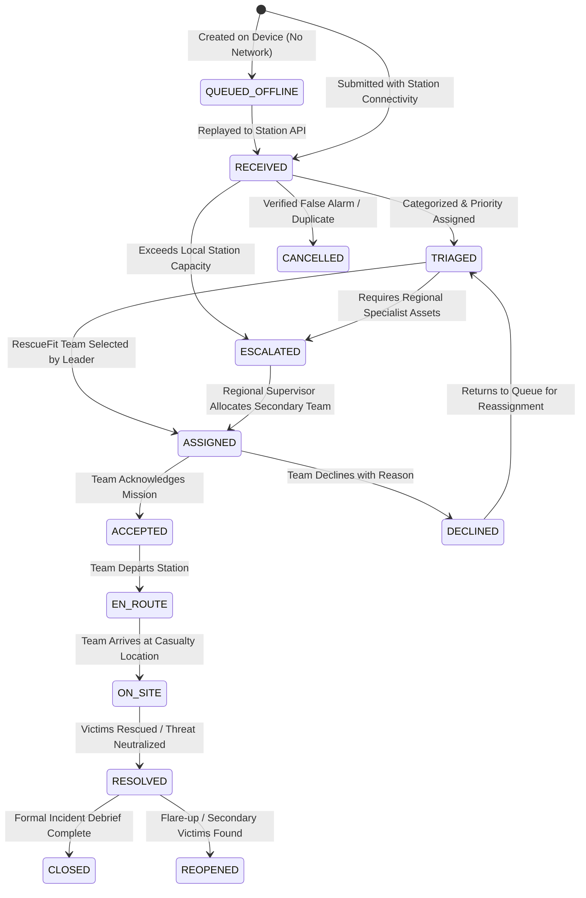
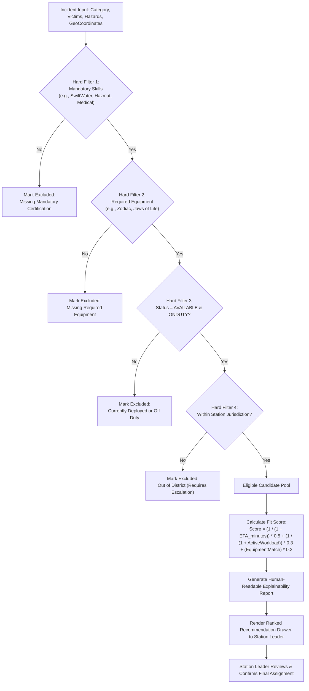

# AmeniEdge: Architectural Specification

## 1. Executive Architecture Summary
AmeniEdge provides a multi-station command hierarchy and resilient edge synchronization for emergency disaster reporting. The architecture decouples local field survival workflows from centralized cloud dependence.

### Core Architectural Layers:
1. **PWA Edge Client (Citizen & Responder Devices)**:
   - Zero-install web application cached via Service Workers (Workbox precache).
   - Local transactional persistence using IndexedDB (Dexie.js).
   - Optimistic offline outbox with exponential backoff and jitter replay.
2. **Station Edge Node (Local Micro-Data Center)**:
   - Wi-Fi AP + Captive Portal DNS redirection (`hostapd` + `dnsmasq`).
   - Reverse proxy routing (`nginx`).
   - Autonomous Spring Boot 3 edge service (REST + STOMP WebSockets).
   - Local H2/PostgreSQL database with sync event journals.
   - Local offline Leaflet map tile repository.
   - Autonomous RescueFit rules dispatch engine.
3. **Regional Central Node (Command & Harmonization Hub)**:
   - Scalable Spring Boot 3 enterprise service.
   - Enterprise PostgreSQL 16 + PostGIS spatial engine.
   - Multi-station causal sync processor (Vector Clocks & conflict management).
   - Cryptographic audit trail and regional incident escalation coordinator.

---

## 2. Immutable Entity Identifiers & Permissions Matrix
All IDs are server-generated, immutable, and strictly distinct from credentials:
- Stations: `STA-[REGION]-[DISTRICT]-[001..999]` (e.g. `STA-CHN-N-001`)
- Teams: `TEAM-[STATION]-[001..999]` (e.g. `TEAM-CHN-N-002`)
- Incidents: `INC-[TIMESTAMP_OR_COUNTER]` (e.g. `INC-10482`)
- Assignments: `ASN-[TIMESTAMP_OR_COUNTER]` (e.g. `ASN-40291`)
- Sync Events: `EVT-[UUIDv4]`

### Role-Based Access Control (RBAC) Matrix

| Domain Operation | Citizen | Volunteer | Rescue Member | Station Leader | Regional Supervisor | Org Admin |
|---|---|---|---|---|---|---|
| Submit Guest SOS | YES | YES | YES | YES | YES | YES |
| View Own SOS Status | YES | YES | YES | YES | YES | YES |
| Update Availability / Skills | NO | YES | YES | NO | NO | NO |
| Accept/Decline Mission Assignment | NO | NO | YES | NO | NO | NO |
| Update Mission Step (En Route / On Site) | NO | NO | YES | NO | NO | NO |
| Triage Local Incidents | NO | NO | NO | YES | YES | YES |
| Execute RescueFit Dispatch | NO | NO | NO | YES | YES | YES |
| Reassign / Cancel Incident | NO | NO | NO | YES | YES | YES |
| Cross-Station Resource Escalation | NO | NO | NO | YES (Request) | YES (Approve) | YES |
| Manage Stations, Users, Audit Logs | NO | NO | NO | NO | NO | YES |

---

## 3. Incident State Machine

---

## 4. RescueFit Decision Algorithm

