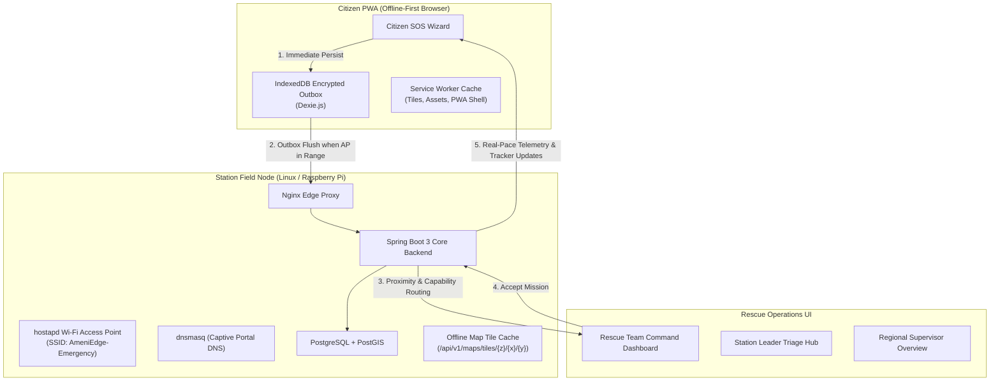
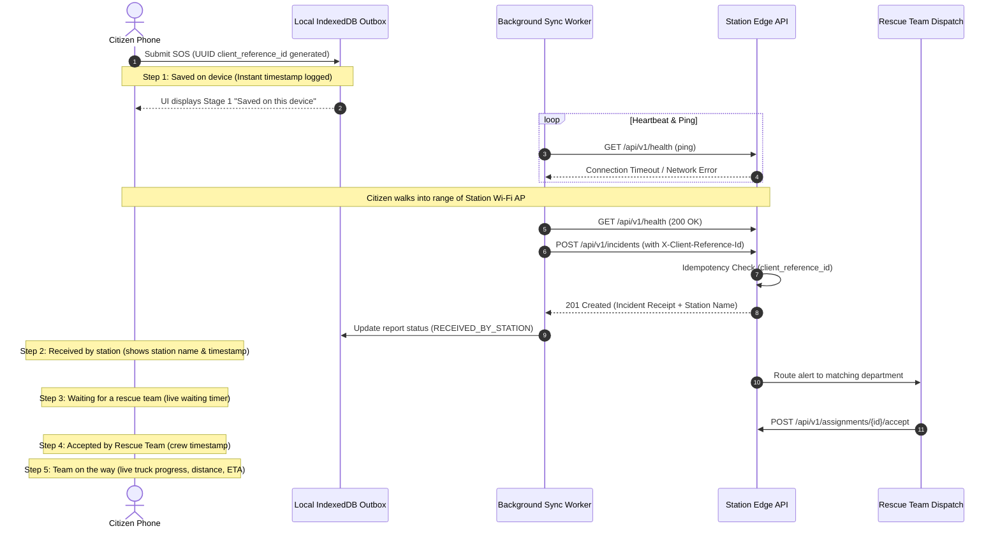

# AmeniEdge: How It Works

This document provides a comprehensive end-to-end technical explanation of AmeniEdge: architecture, data lifecycle, networking modes, failure semantics, and engineering tradeoffs.

---

## 1. High-Level System Architecture & Flow

---

## 2. Operating Modes: Online vs. Station Wi-Fi Mode

| Aspect | Online Cloud Mode | Station Wi-Fi Edge Mode |
| :--- | :--- | :--- |
| **Network Path** | Public Internet (LTE, 5G, Fiber) to Cloud VM | Local RF Wi-Fi direct to Station Node (802.11 b/g/n) |
| **Infrastructure Needed** | Commercial telecom towers, cloud VPC | Standalone battery/solar powered Linux hardware |
| **DNS Resolution** | Public DNS resolvers | `dnsmasq` wildcard intercept (`*.ameniedge.local` / captive portal) |
| **Map Rendering** | Local cache first, OSM tile fallback | Station-hosted pre-rendered raster tile slices (z11-z16) |
| **Range** | Global cellular reach | ~150m to 600m line-of-sight around physical station AP antenna |
| **Resilience** | Vulnerable to storm power cuts & tower floods | Operates completely off-grid when all regional telecom is down |

---

## 3. Offline Store-and-Forward: The Device Outbox Lifecycle

When a citizen presses the SOS button during a disaster, cellular infrastructure is frequently destroyed. AmeniEdge guarantees that **no report is ever dropped due to network failure**.

### Lifecycle Sequence:

### Idempotency & Deduplication:
- Every report generates a cryptographic UUIDv4 `client_reference_id` client-side upon creation.
- When network reconnects, if a retry occurs due to a dropped HTTP ACK, the backend enforces a unique constraint on `incidents.client_reference_id`.
- Duplicate submissions return the existing incident record without generating redundant dispatch tickets or incrementing active casualty numbers.

---

## 4. Station Field Node Architecture

A field station node runs on low-power commodity hardware (Raspberry Pi 4/5, Intel NUC, or rugged Linux laptop) configured with:
1. **hostapd**: Creates an unencrypted autonomous Wi-Fi access point:
   - SSID: `AmeniEdge-Emergency`
   - Broadcasts on 2.4 GHz channel 6 for maximum penetration through masonry and wet foliage.
2. **dnsmasq**:
   - DHCP server issuing `192.168.44.0/24` leases with 15-minute lease times.
   - Captive portal wildcard DNS: all requests redirect to `192.168.44.1`.
3. **Nginx Edge**:
   - Reverse proxy routing `/api/` to Spring Boot on port 8081, `/ws` to WebSocket brokers, and static PWA assets from disk.
4. **PostgreSQL 16 + PostGIS**:
   - Spatial indexing via `ST_DWithin` and spatial distance queries via `ST_DistanceSphere`.
5. **Local Tile Server**:
   - MBTiles / pre-seeded folder slice serving offline raster tiles directly without internet access.

---

## 5. Station-to-Station Sync & Mesh Uplinks

In a large disaster, multiple stations (North, South, Central) operate independently. When intermittent connectivity exists between stations (e.g. directional Wi-Fi bridge, LoRa packet radio, or physical USB sneaker-net):
- Changes are captured in an append-only `sync_events` table.
- Each event is signed with an HMAC-SHA256 signature using a pre-shared station network key.
- Conflict resolution uses monotonic Lamport timestamps and client reference IDs to ensure idempotent, convergent state across stations.

---

## 6. Honest Engineering Limits (What AmeniEdge Does NOT Claim)

We believe disaster technology must be brutally honest about its constraints:
1. **No Magic Cellular-Free Long-Range P2P Between Citizen Phones**:
   - Standard consumer smartphones cannot transmit Wi-Fi or Bluetooth beyond 30–70 meters without specialized external transceivers (e.g. goTenna, LoRa 915MHz dongles).
   - AmeniEdge relies on citizens connecting to designated Station APs or outbox store-and-forward as they move.
2. **WebSocket Limits**:
   - WebSockets provide sub-second updates *only while the device is actively associated with the station AP*.
   - When a citizen roams out of Wi-Fi range, the app automatically switches to polling and IndexedDB offline cache.
3. **No 99.99% Cloud SLA Guarantees**:
   - In catastrophic floods or earthquakes, physical antennas can be submerged or crushed. The system is designed to degrade gracefully: individual stations continue operating autonomously even if all peer links are severed.

---

## 7. Failure Mode Matrix

| Failure Mode | System Behavior | Citizen Experience | Responder Experience |
| :--- | :--- | :--- | :--- |
| **Total Internet Outage** | Autonomous Station AP takes over local coordination | Full functionality within station Wi-Fi radius | Full dispatch, map, telemetry & reporting active |
| **Citizen Outside Station Range** | Outbox captures report in IndexedDB | "Saved on this device · Waiting for station link" | Report appears as soon as citizen enters Wi-Fi range |
| **Rescue Unit Declines Mission** | Mission reverts to WAITING with mandatory decline reason | Step 3 displays: "Declined: [Reason] · Reassigning..." | Alert reappears in department triage queue for next unit |
| **Truck Arrival Gate Failure** | Arrival gate prevents closing mission prematurely | Tracker shows real-time truck distance and ETA | Responders cannot resolve until truck reaches incident GPS |
| **Browser Closed During SOS** | Service Worker & IndexedDB persist outbox across reboots | Report automatically reloaded upon reopening app | Uninterrupted delivery upon background sync |

---

## 8. What Makes AmeniEdge Different

| Metric | Traditional Cloud Emergency App | AmeniEdge Resilience Platform |
| :--- | :--- | :--- |
| **Dependency on Telco Towers** | 100% required (fails if cell towers die) | 0% required (runs on local RF station AP) |
| **Data Loss on Disconnect** | Form resets / network error dialog | 0% data loss (IndexedDB outbox store-and-forward) |
| **Tracker Honesty** | Often displays fake immediate "Dispatched" | Decoupled 4-state lifecycle with verified timestamps |
| **Arrival Verification** | Responders can mark complete from anywhere | Arrival gate blocks resolution until physical proximity confirmed |
| **Map Rendering** | Blank grey boxes when offline | 3-tier fallback (Local Tiles $\rightarrow$ OSM $\rightarrow$ Vector Grid) |

