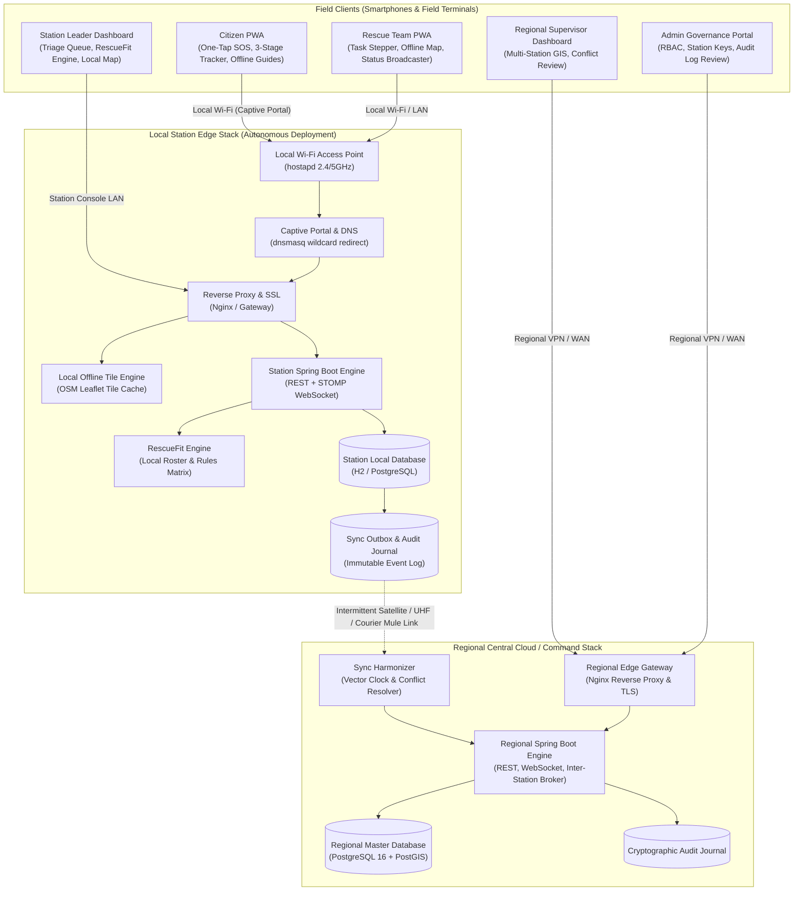
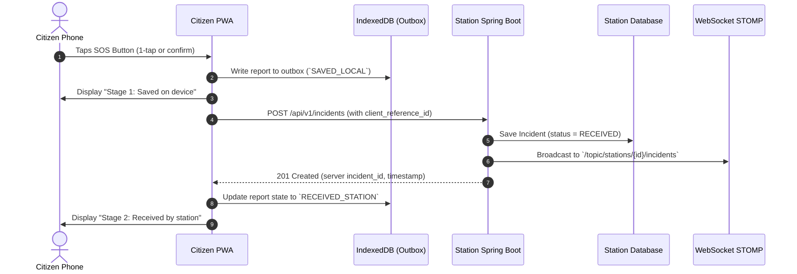
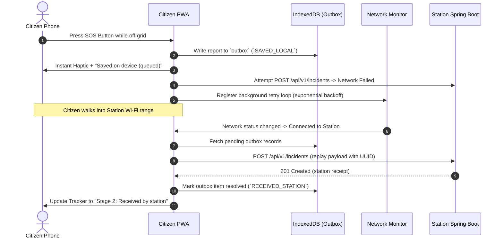
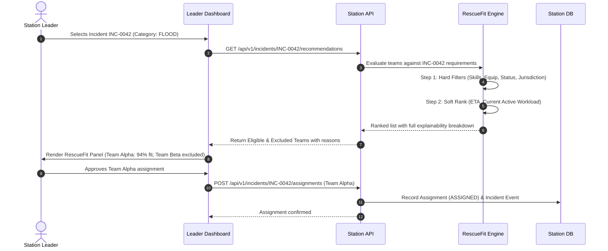
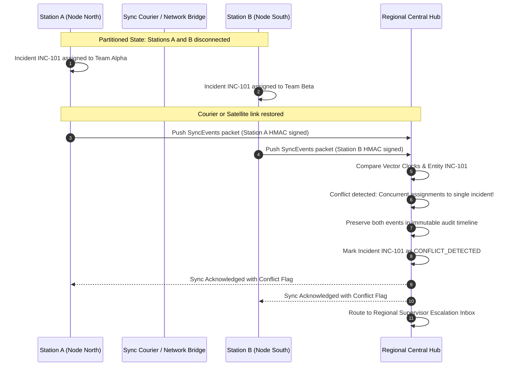
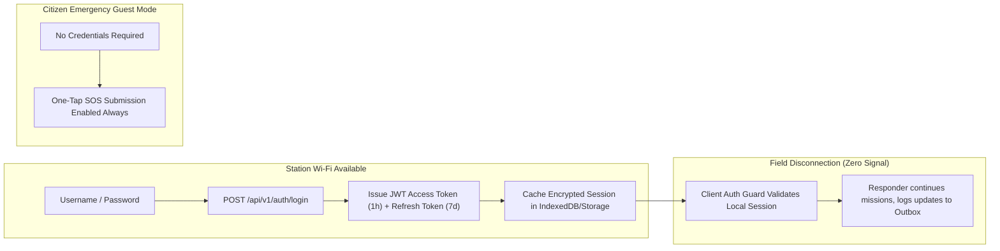

# AmeniEdge: System Design Specification

## 1. System Overview and Architectural Vision
**AmeniEdge** is an offline-first emergency reporting and rescue coordination platform designed for multi-tier disaster response operations when public telecommunications, cellular towers, and regional power grids fail.

The platform follows a **Two-Layer Edge Mesh Hierarchy**:
1. **Local Station Edge Layer (Autonomous Island Mode)**: Operates 100% disconnected from the internet. Each station runs an independent micro-data center on rugged hardware (Raspberry Pi 4/5 or field laptop) providing an autonomous Wi-Fi Access Point, local DNS captive portal, local Web PWA, local Spring Boot REST/WebSocket engine, local embedded/containerized database, and local OpenStreetMap vector/raster tile cache.
2. **Central Regional Layer (Global Coordination & Synchronization)**: Orchestrates inter-station escalations, regional resource logistics, high-capacity PostGIS geospatial analysis, multi-station synchronizations, and verified administrative governance.

---

## 2. Component Diagram



---

## 3. Deployment Topology

### A. Autonomous Station Edge Deployment
The Station node is packed into an all-in-one deployable unit (e.g., Pelican case with Raspberry Pi 5 + battery backup, or an off-grid field laptop):
- **Physical Wi-Fi Interface (`wlan0`)**: Configured with `hostapd` emitting an open SSID (e.g., `AmeniEdge-Station-North-SOS`).
- **DHCP & DNS (`dnsmasq`)**: Subnet `192.168.4.0/24`. All DNS requests (`*`) resolve to `192.168.4.1`.
- **Captive Portal Rules (`iptables` / `nftables`)**: HTTP traffic (port 80) is intercepted and HTTP 302-redirected to `http://192.168.4.1/sos`.
- **Docker Compose Stack**:
  1. `ameniedge-edge-proxy`: Nginx on port 80/443, proxying frontend static assets, `/api/v1/*` to backend, `/ws/*` for WebSocket, and `/api/v1/maps/tiles/*` to the tile directory.
  2. `ameniedge-edge-backend`: Spring Boot 3 service running with profile `station-edge`.
  3. `ameniedge-edge-db`: Embedded H2 file store or containerized lightweight PostgreSQL.
  4. `ameniedge-tile-cache`: Local directory of Leaflet-compatible XYZ tiles covering the local district.

### B. Regional Central Cloud Deployment
- **Docker Compose / Kubernetes Stack**:
  1. `ameniedge-central-proxy`: TLS termination, WAF, rate-limiting.
  2. `ameniedge-central-backend`: Spring Boot 3 running profile `central-regional`.
  3. `ameniedge-central-db`: High-availability PostgreSQL 16 with PostGIS extension.
  4. `ameniedge-central-sync`: Mutual-TLS (mTLS) sync receiver for station packet sync.

---

## 4. Backend Module Boundaries (Spring Boot Clean Architecture)

The backend code is strictly structured into modular domain packages within `com.ameniedge`:

```
com.ameniedge
├── common              # Base entities, audit tracking, exception hierarchy, error payloads
├── auth                # Authentication, JWT handling, mTLS station token verification, Argon2/BCrypt
├── users               # User identities, credentials, profile information
├── organization        # Multi-tier hierarchy: Regions, Stations, Teams, Capabilities, Equipment
├── incidents           # Lifecycle state machine, SOS intake, triage, priority scoring
├── assignments         # Responder dispatch assignments, acknowledgement, operational status
├── rescuefit           # Explainable rule-based dispatch engine, qualification matrix, ETA scoring
├── sync                # Store-and-forward outbox, vector clocking, conflict detection, station handshakes
├── maps                # Offline OSM tile server controller, shelter & hazard spatial layers
├── bulletins           # Verified official alerts, civil defense broadcasts
├── volunteers          # Community responder rostering, shift check-in/out, skill registry
├── attachments         # Evidence uploads, mime validation, EXIF sanitation, offline chunks
├── audit               # Immutable append-only audit trail and compliance logging
└── notifications       # STOMP WebSocket topics and simulated SMS/emergency broadcasts
```

**Module Rule**: Cross-domain interactions occur strictly through explicit service interfaces (`IncidentService`, `RescueFitEngine`, `SyncService`), never by direct cross-repository queries or leaky abstractions.

---

## 5. Frontend Architecture and Client State Management

```
frontend/
├── public/
│   ├── manifest.json       # PWA Manifest with maskable icons and standalone display
│   ├── sw.js               # Service Worker with Workbox precaching and offline fallback
│   └── tiles/              # Offline seed tiles for default operational district
├── src/
│   ├── app/                # Root App, Providers (Auth, QueryClient, Theme, Toast), Router
│   ├── components/
│   │   └── ui/             # Accessible Design System Primitives (Button, SOSButton, Card, Sheet, etc.)
│   ├── features/
│   │   ├── sos/            # Citizen emergency report step-wizard, one-tap trigger, 3-stage tracker
│   │   ├── incidents/      # Station incident queue, triage panel, filter controls
│   │   ├── dispatch/       # RescueFit explainable recommendation drawer, assignment confirm
│   │   ├── teams/          # Responder status stepper, glove-friendly big buttons, assignment cards
│   │   ├── supervisor/     # Regional overview, cross-station escalation, multi-node GIS
│   │   ├── maps/           # Leaflet offline map component, custom SVG markers, layer toggle sheets
│   │   ├── sync/           # Connectivity & sync top bar, outbox inspector, retry diagnostics
│   │   └── admin/          # RBAC tables, station key generator, audit trail viewer
│   ├── hooks/              # Custom hooks: useNetworkStatus, useGeolocation, useOutbox, useAudioHaptic
│   ├── lib/
│   │   ├── api/            # Axios / Fetch client with offline interceptors and auth headers
│   │   ├── db/             # Dexie.js IndexedDB schema (outbox, reports, tiles, cache)
│   │   ├── offline/        # Outbox synchronization engine with exponential backoff & jitter
│   │   ├── i18n/           # Internationalization dictionaries (English, Spanish, Hindi, etc.)
│   │   └── a11y/           # Focus traps, announcePolite, screen reader helpers
│   └── styles/
│       ├── tokens.css      # CSS custom properties (color roles, elevation, spacing grid, typography)
│       └── main.css        # Reset, fluid viewport heights, safe-area-inset rules
```

---

## 6. Sequence Diagrams

### (a) Citizen SOS Submission (Online / Station Connected)


### (b) Citizen SOS Submission (No Connection, Queued, Later Delivered)


### (c) Station Leader Assignment with RescueFit Explanation


### (d) Two-Station Sync with Conflict Detection


---

## 7. Offline Queue and Synchronization Design

### The Outbox Schema (IndexedDB)
Every mutating client action (SOS creation, triage, team status change) is stored atomically in IndexedDB table `outbox`:
```typescript
interface OutboxRecord {
  client_reference_id: string; // Client-generated UUIDv4
  endpoint: string;            // e.g. '/api/v1/incidents'
  method: 'POST' | 'PATCH' | 'PUT';
  payload: Record<string, unknown>;
  created_at: number;          // Epoch milliseconds
  attempt_count: number;
  last_attempt_at: number | null;
  status: 'PENDING' | 'SENDING' | 'FAILED' | 'CONFIRMED';
  error_message?: string;
}
```

### Client Delivery Engine
1. **Mutation**: User taps action -> record committed to IndexedDB outbox.
2. **Optimistic UI**: UI immediately updates local state from outbox records.
3. **Dispatcher Loop**:
   - Listens to `online` and `offline` browser events.
   - Pings station health endpoint (`GET /api/v1/health`) every 8 seconds.
   - When healthy, flushes queue sequentially in FIFO order.
   - Includes retry delay with jitter: `delay = min(30000, 1000 * (2 ^ attempts)) + random(0, 500)`.
4. **Idempotency Guarantee**: The backend uses `client_reference_id` as a unique database constraint. Replays return the original success receipt (`HTTP 200/201`) without duplicating entities.

---

## 8. Offline Authentication & Session Continuity



- **Citizens**: Require zero authentication. Guest SOS reporting is unrestricted to guarantee zero friction during acute trauma.
- **Responders and Leaders**: Authenticate against the local station API when in station Wi-Fi range. The client persists session tokens with role and station claims. When leaving coverage, the client runs from cached session metadata.

---

## 9. Failure Mode Analysis

| Component / Subsystem | Failure Scenario | User Experience & System Response | Recovery Procedure |
|---|---|---|---|
| **Station Power** | Power grid blackout or generator failure | Station drops off-line. Citizen app transitions top bar to "Offline (saved on device)". New reports buffer in device IndexedDB outbox. | Station reboots on backup DC battery or solar generator; outbox auto-syncs upon reconnect. |
| **Local Wi-Fi Access Point** | Wi-Fi radio failure or physical antenna damage | Devices disconnect. UI displays "Station Disconnected. Stored locally." | Secondary station node or mobile responder hotspot assumes station identity. |
| **GPS / Geolocation** | Cloud cover, urban canyon, or user denies permission | App detects GPS timeout/denial. Instantly displays fallback: interactive pin on offline map or manual landmark/address text input. Never blocks report. | Accuracy circle expands; manual coordinates recorded. |
| **Map Tile Server** | Corrupted tile file or missing zoom levels | Leaflet falls back to placeholder grid with coordinate overlay. Incident list view remains 100% operational. | Tile pack re-download or fallback to vector bounding box. |
| **Sync Link (Station to Central)** | Terrestrial backhaul cut, satellite link obstructed | Station switches to "Autonomous Island Mode". All local triage, RescueFit dispatch, and team missions proceed normally. | Courier mule drive or restored uplink reconciles queued sync events via causal vector clocks. |
| **Concurrent Dispatched Teams** | Two stations dispatch different teams to same boundary event | Both station leader logs preserved. System flags `CONFLICT_DETECTED` with audible chime on supervisor dashboard. | Regional supervisor clicks "Arbitrate Conflict" to confirm primary responder and notify secondary. |

---

## 10. Real-Time Communication Layer (WebSocket + Polling Fallback)

- **Primary**: Spring WebSocket with STOMP protocol.
  - Topics:
    - `/topic/stations/{stationId}/incidents` (Local incident intake and status changes)
    - `/topic/stations/{stationId}/teams` (Responder telemetry and availability)
    - `/topic/incidents/{incidentId}` (Specific mission updates and notes)
    - `/topic/regional/escalations` (Supervisor alerts and conflict notifications)
- **Fallback**: Adaptive HTTP Long-Polling / Polling every 5–10 seconds whenever WebSocket connection drops.
- **Top Bar Indicator**:
  - `Live (WebSocket Connected)` (Green beacon)
  - `Delayed (HTTP Polling Active)` (Amber beacon)
  - `Offline (Local Outbox Active)` (Neutral gray beacon with pending badge count)

